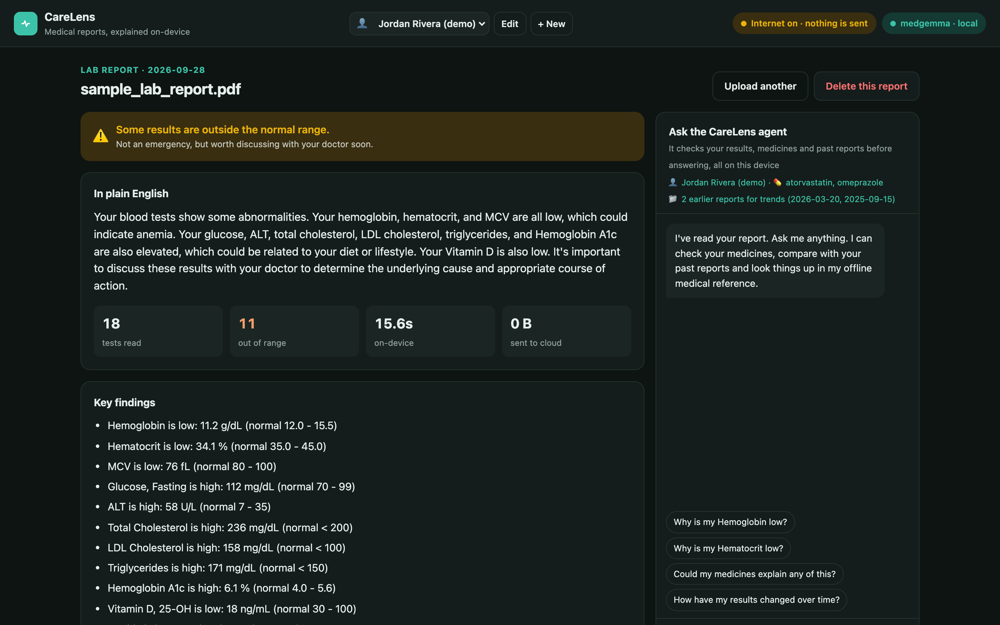
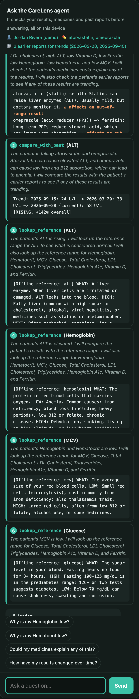
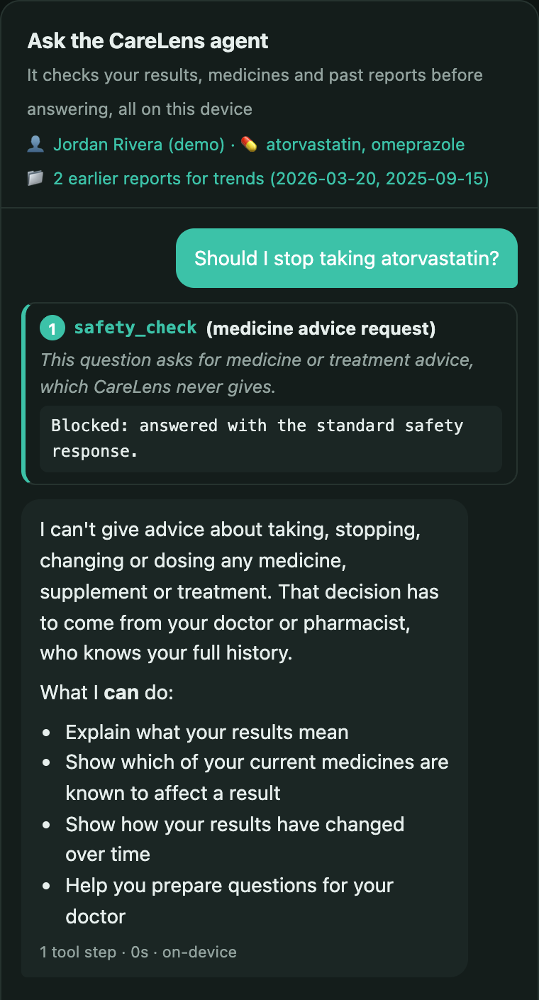

# CareLens

**A medical-report AI agent that runs entirely on your own computer.**

Upload a lab report, and a medical AI model (Google's MedGemma, running locally through Ollama) explains it in plain English. Every value is checked by code against the reference range printed on the report, and an agent looks into your medicines and past reports before answering your questions. No cloud, no API keys, no account, and it works with the internet switched off.



## Why

People are increasingly uploading their medical records to cloud chatbots. Once a consumer AI app has your records, HIPAA no longer protects them; only the company's privacy policy does. CareLens takes the opposite approach: **your health data never leaves your machine.**

It also avoids a known weakness of chatbots. Studies have found general LLM answers to lab-result questions appropriate only about half the time. CareLens never lets the AI decide whether a number is high or low. **Code checks the numbers, and the AI only explains them.**

## Features

| | |
|---|---|
| 📄 **Report explainer** | Upload a PDF, photo or scan and get a plain-English summary, per-test explanations, and questions to ask your doctor |
| ✓ **Range checks in code** | Each value is compared in code with the reference range printed on the report. Numbers the AI invents are dropped. |
| 🕵️ **Agent that investigates** | Before answering, the agent picks its own tools: it reads results, searches an offline medical reference, checks your medicines and compares past reports |
| 👀 **Live reasoning** | Every tool step appears on screen as it happens, so you can see *why* it said what it said |
| 📈 **Trends over time** | Rising, falling or stable is computed by code across your saved reports (e.g. ferritin 41 → 22 → 9, falling) |
| 👤 **Local profiles** | Medicines, conditions and report history are stored in a local file and never uploaded |
| 🛡️ **No medicine advice** | Requests to start, stop or dose any medicine are blocked in code before the model sees them |

<table>
<tr>
<td width="50%"><br/><sub>The agent's own tool calls, streamed live</sub></td>
<td width="50%"><br/><sub>Medicine advice is blocked in code</sub></td>
</tr>
</table>

## How it works

```
Report ─► text + table extraction (PyMuPDF)
          ├─ readable table ─► code reads every value (exact, instant)
          └─ photo / scan   ─► MedGemma reads the image (vision), with one retry
       ─► code checks each value against the report's own reference range
       ─► MedGemma writes the explanation, given only the code-checked results
       ─► saved to the patient's local profile

Question ─► code safety check (blocks medicine/dosing advice)
         ─► agent loop, max 6 steps; MedGemma picks one tool per step:
              get_results · lookup_reference · check_medications · compare_with_past · calculate
         ─► each step streamed to the UI (NDJSON)
         ─► final answer written from the gathered facts, with a repeat guard
```

**Design decisions**

- **The AI explains; code decides.** Out-of-range flags, trend directions, key findings and the "affects an out-of-range result" markers all come from code. Wherever the model and the math disagreed during testing, I moved that decision into code.
- **A custom agent loop.** Gemma-family models don't support Ollama's native tool calling, so each step is a JSON-schema-constrained `{thought, tool, input}` decision that the backend executes. It works with any local model.
- **Defenses for small models.** A 4B model sometimes loops or drifts. CareLens caps generation length, retries broken JSON, writes the final answer in a fresh context (so it doesn't imitate the JSON steps), and stops streaming when a line repeats.
- **No build step, no CDN.** The frontend is plain HTML, CSS and JS, so it works fully offline.

## Run it

Requirements: Python 3.11+ and [Ollama](https://ollama.com).

```bash
./run.sh
```

This pulls MedGemma (first run only, about 3 GB), creates a virtualenv, generates the synthetic sample reports and starts the app at **http://localhost:8765**.

On first run, a fictional demo patient (**Jordan Rivera**) is created with two earlier reports. Click **Try a sample report**, then try the suggested questions:

- *"Could my medicines explain any of this?"*
- *"How have my results changed over time?"*
- *"Should I stop taking atorvastatin?"* (watch it get blocked)

**Bigger model:** on a machine with enough memory (for example a 128 GB workstation), use the 27B MedGemma for more accurate explanations:

```bash
CARELENS_MODEL=medgemma:27b ./run.sh
```

Settings (environment variables): `CARELENS_MODEL` (default `medgemma`), `OLLAMA_URL` (default `http://localhost:11434`), `CARELENS_DATA` (default `data/profiles.json`) and `PORT` (default `8765`).

## Project structure

| Path | Purpose |
|---|---|
| `backend/main.py` | FastAPI app: report analysis, agent endpoint, profiles |
| `backend/agent.py` | Agent loop, tools, safety rules and repeat guard |
| `backend/profiles.py` | Local profile and report storage |
| `backend/knowledge.json` | Offline reference: what tests mean and known medicine effects (no treatment advice) |
| `frontend/` | UI: plain HTML/CSS/JS |
| `samples/make_sample.py` | Generates the synthetic demo reports |

## Safety

CareLens is an **educational prototype, not a medical device**, and it is not for clinical use. It explains reports. **It never diagnoses, and it never recommends, starts, stops, changes or doses any medicine, supplement or treatment.** This is enforced in three layers:

1. **Code block** (`MED_ADVICE` in `backend/agent.py`): advice requests get a fixed reply before the model sees them.
2. **Prompt rules** (`SAFETY_RULES`): the model may only say that a medicine the patient *already takes* is *known to affect* a value.
3. **Reference with no advice**: `knowledge.json` has no treatment or dosing text, and any answer involving medicines ends with a fixed "talk to your doctor or pharmacist" notice.

All demo data is **synthetic**. Use of MedGemma is subject to Google's [Health AI Developer Foundations terms of use](https://developers.google.com/health-ai-developer-foundations/terms).

## Limitations

- Tested mainly on **PDF lab reports with a readable table**. Photos and scans go through MedGemma vision, which is less reliable.
- The offline reference covers about **18 common tests** and **10 medicines**.
- With the 4B model, free-text wording can still be imperfect; the code-checked flags and trends on screen are the source of truth.
- Reference ranges come from the report itself, so they are not adjusted for age or sex.
- Profiles are stored as plain JSON on disk; there is no encryption at rest yet.

## License

[MIT](LICENSE)
